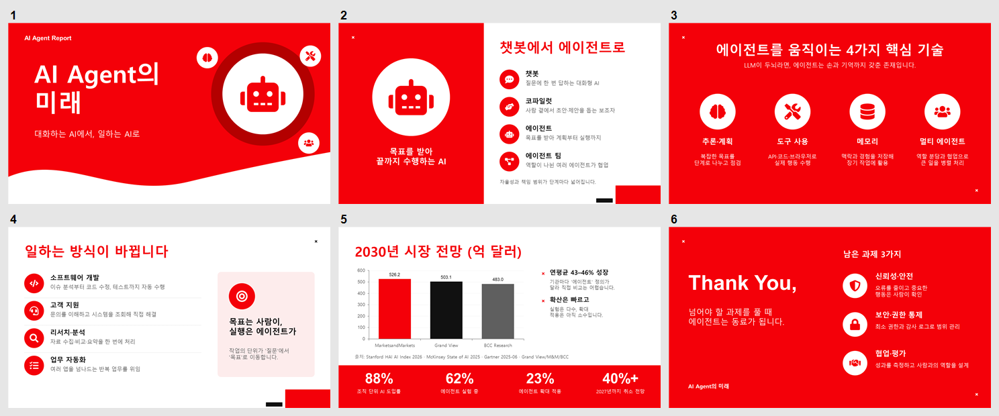

# my_pptx

빨강 주도 투자자 발표(Red Pitch Deck) 스타일의 한국어 PPT를 만드는 Claude 스킬.



## 구성

- `SKILL.md` — 스킬 본문 (트리거, 작업 순서, API, 테마, 환경 팁)
- `theme.json` — 색·글꼴 토큰 (바꾸면 다른 브랜드 색으로 같은 레이아웃 사용)
- `references/brandguideline.md` — 색상·타이포·레이아웃 6유형·모티프·체크리스트
- `scripts/setup.ps1` — 환경 준비 (디스크 확인, 휴대용 Node + SHA256 검증, npm 설치)
- `scripts/build.js` — 덱 정의 JSON → .pptx (노트·출처·유형 사전 검사)
- `scripts/brand.js` — 레이아웃 A–F 함수 라이브러리 (한글 자동 줄바꿈, 넘침 경고)
- `scripts/brand_lint.py` — 완성된 .pptx 브랜드 규칙 검사기
- `scripts/render.ps1` — PowerPoint COM 렌더링 + 미리보기 시트
- `examples/sample_deck.json` / `sample_deck.js` — 6유형 예제 덱 (위 미리보기)
- `evals/trigger_evals.json` — 스킬 호출 조건 테스트 문장

## 빠른 시작 (Windows PowerShell)

```powershell
powershell -ExecutionPolicy Bypass -File <skill>\scripts\setup.ps1 -WorkDir C:\work\pptx
cd C:\work\pptx
node skill\scripts\build.js skill\examples\sample_deck.json sample.pptx
$env:PYTHONUTF8 = "1"; python skill\scripts\brand_lint.py sample.pptx
powershell -ExecutionPolicy Bypass -File skill\scripts\render.ps1 -Pptx sample.pptx
```

`node`가 PATH에 없으면 setup.ps1이 마지막에 출력하는 `NODE =` 경로로 실행한다.

## 설치

이 폴더를 `~/.claude/skills/my_pptx/` (또는 프로젝트의 `.claude/skills/my_pptx/`)에 복사.

참고 이미지 기반 스타일(색·구성)만 차용했으며 특정 기업의 로고·상표 에셋은 포함하지 않는다.
